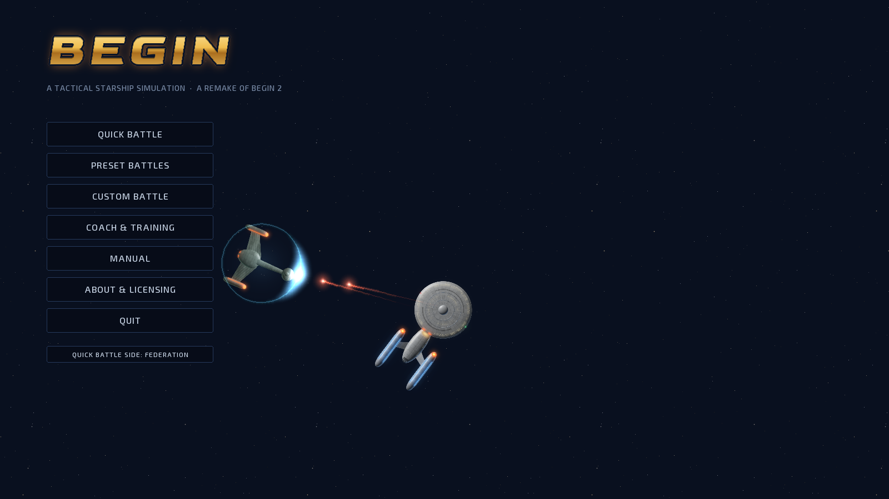
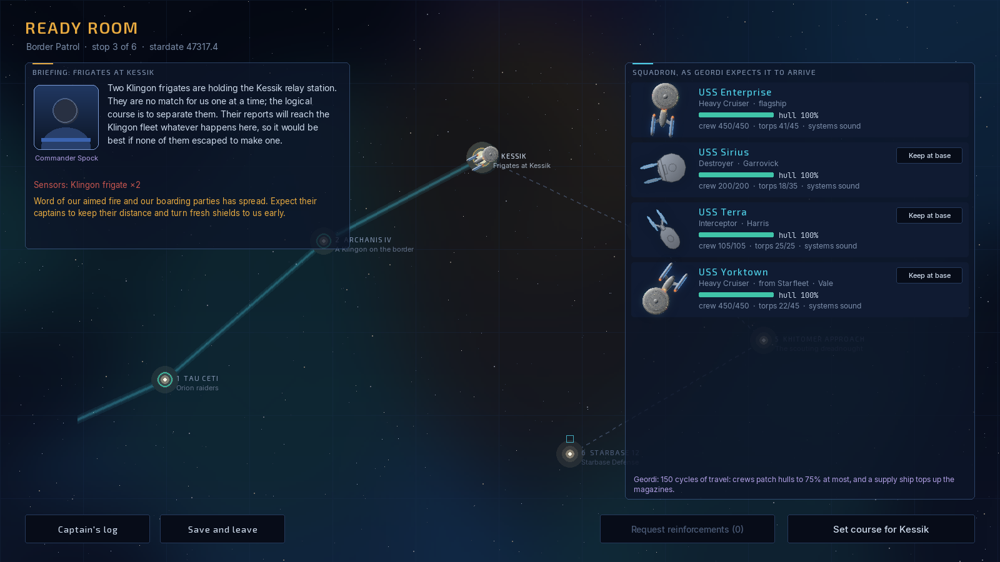
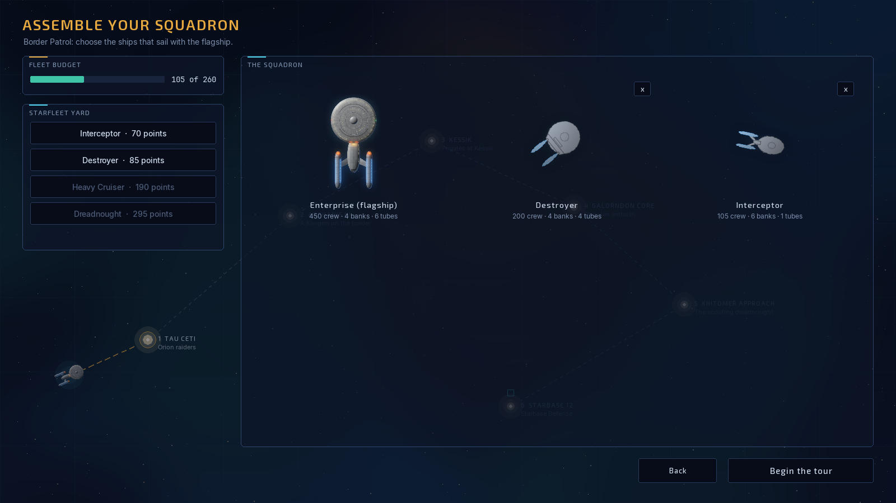
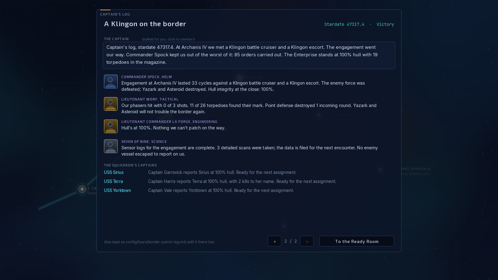
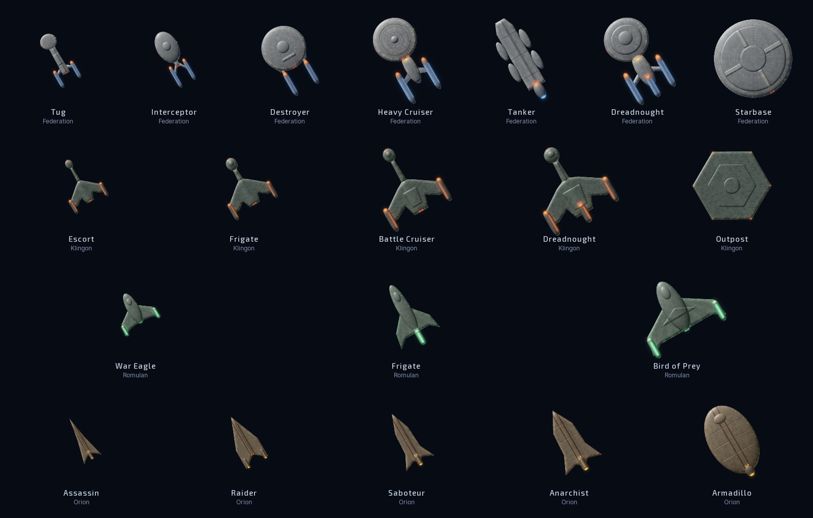
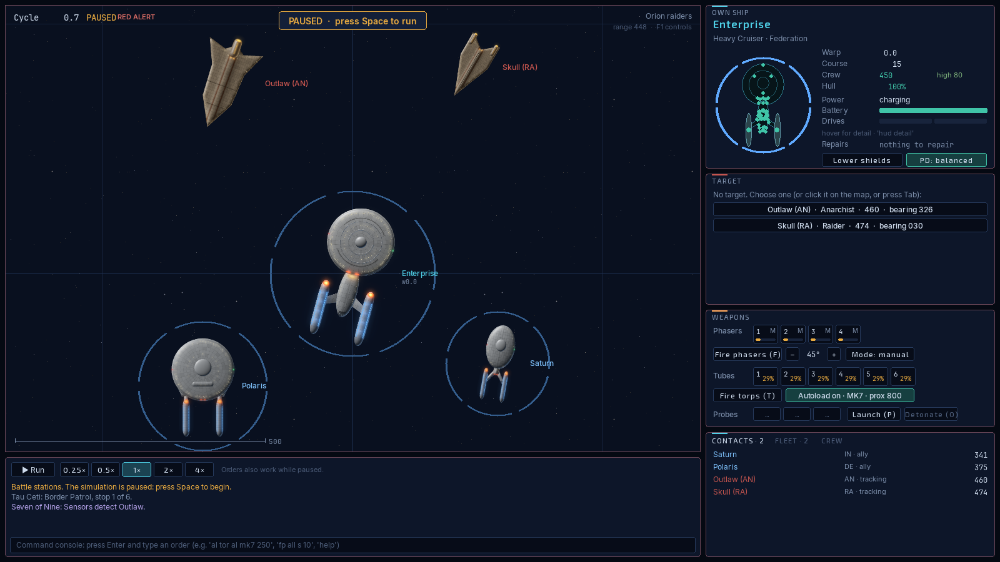
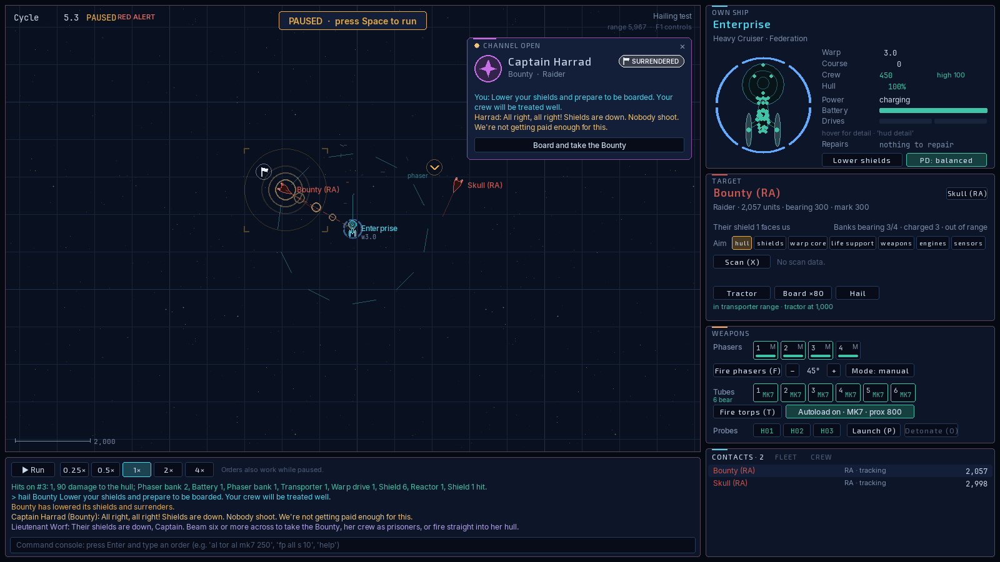

# Begin (remake)



A real-time 2D tactical starship simulation in Python and pygame-ce, and my own bottom-up rebuild of a game I loved: *Begin: A Tactical Starship Simulation* (Clockwork Software, v1.65 with the Begin 2.0 appendix). It isn't a port. The simulation, AI captains, console, HUD, effects, sound and manual are all new code, written from scratch against Begin's published manual and its rules. Two sources made that possible, and I'm grateful to both. The original manual defined how the game should play. The [fireflyk64/begin](https://github.com/fireflyk64/begin) reverse-engineered reconstruction gave me the original ship statistics and decoded formulas, which I reimplemented so the fights feel like Begin's. Where my version departs from Begin, [docs/DEVIATIONS.md](docs/DEVIATIONS.md) says how and why. It is a personal, non-commercial fan project: see [LICENSING.md](LICENSING.md).

You command a starship from a top-down tactical map and a Begin-style command console. The core is Begin's: six shield sectors, phaser banks that hit harder up close, torpedoes with arming and proximity fuses, heat, power, probes and cloaks. Around it I've built a lot that Begin never had:

- a bridge crew who can fight the ship for you, take orders in plain words, and talk back;
- named battle plans and a coach that reads the fight;
- aimed fire at a ship's systems, and boarding parties that take and keep enemy ships;
- enemy captains you can hail, who are cowed or enraged by what you do to their allies, and who can be talked into surrendering or leaving;
- a campaign: tours of duty that link battle after battle, with a squadron that carries its scars;
- crew morale and hull repairs;
- every ship class drawn as a lit, detailed model;
- synthesised sound and effects, and a HUD that keeps to the essentials until you ask for more.


## A campaign Begin never had

Begin was a game of single battles: you fought, you won or lost, and the next fight started from nothing. The biggest thing I've added is the **tour of duty**, and it changes what the game is. You take a squadron of your own choosing out on a patrol of five or six stops, and nothing resets between them. The destroyer that lost half her hull at Tau Ceti limps into Kessik with whatever her crew could patch on the way. The torpedoes you spent on the raiders are not there for the dreadnought. A Klingon frigate your boarding party took is now flying in your line, and a ship you lose is gone for the rest of the tour. If the Enterprise falls, the tour is over.

Between stops you sit in the Ready Room over the patrol chart. The officer who knows the threat best briefs you, including what the enemy has learned about the way you fight: lean on aimed fire and boarding and their captains grow wary; run your magazines dry and they close in. Some stops ask you to decide, such as whether to put in for a refit while the enemy uses the same time. You can call Starfleet for reinforcements, and they arrive when the distance allows, not when you need them. Starbase stops come in waves, with a lull to dock and repair before the next one drops out of warp.

And the tour writes itself down. After each stop your bridge officers report on their stations, each captain in the squadron reports on their own ship, and your own entry is drafted for you to keep or rewrite. With a language model configured, the officers write in their own voices. The whole log is kept as Markdown you can edit, so a tour ends as a story of the patrol you actually flew. More on how it plays is under [Tours of duty](#tours-of-duty) below.



## Download and play

No Python needed: the [Releases page](https://github.com/marlinspike/trek/releases) has a ready-to-run game for Windows (`Begin-windows.exe`), Macs with Apple Silicon or Intel chips (`Begin-mac-*.zip`, holding `Begin.app`) and Linux (`Begin-linux-x86_64.tar.gz`). Download the one for your computer and open it. The builds aren't signed with a paid certificate, so the first launch needs one extra click: on Windows choose **More info**, then **Run anyway**; on a Mac, move `Begin.app` into Applications, open it, then allow it under **System Settings > Privacy & Security > Open Anyway**. The release notes walk through it.

The downloaded game keeps its settings in a `Begin config` folder beside itself (beside `Begin.app` on a Mac), never in your home folder. It holds the same plain text files as `config/` below, starts with a README and the example files, and the **Open config folder** button on the main menu opens it. The officers' language model is optional there too.

Builds are made by GitHub Actions ([.github/workflows/release.yml](.github/workflows/release.yml), with the PyInstaller recipe in [packaging/](packaging/)). They run only when a version tag such as `v0.2.0` is pushed, which builds all four and publishes them as a release. The only check on pull requests and pushes to main is lint (`ruff check`, [.github/workflows/lint.yml](.github/workflows/lint.yml)); run the tests locally with `pytest` before pushing.

## Run it from source

```bash
python3 -m venv .venv && source .venv/bin/activate
pip install -e ".[dev]"
begin                      # or: python -m begin
```

You need Python 3.10 or newer. macOS's system `python3` is 3.9, which is too old, so install a newer Python first (for example from python.org or with `brew install python`) and create the venv with it. On 3.10, `tomli` is installed automatically. Any Python version with a pygame-ce wheel works.

If `begin` works but `python -m begin` says `No module named begin`, the venv's `python` link points at a different Python from the one the game was installed into. That happens when a venv first made with macOS's Python 3.9 is upgraded in place. Check with `ls -l .venv/bin/python*`, then rebuild the venv with the newer Python (`python3.15 -m venv --clear .venv`, then reinstall), or just use the `begin` command.

Useful shortcuts:

| Command | What it does |
|---|---|
| `begin --preset border-incident` | Jumps straight into a preset battle (ids are in `src/begin/content/data/presets.toml`). |
| `begin --quick 42` | Starts seeded quick battle number 42: your ship against two enemies. |
| `begin --preset fleet-action --cycles 30 --screenshot shot.png` | Simulates 30 cycles headlessly and saves a screenshot. |
| `begin --tournament 20` | Runs 20 headless AI-versus-AI battles and prints a balance summary. |
| `begin --balance 8` | Fights every preset 8 times with AI captains on both sides and prints win rates. |
| `begin --tour-test 6` | Flies every tour of duty 6 times with the officers in command and prints how many were won. |
| `begin --llm provider=ollama model=lfm3 think=off` | Saves the officers' language model settings. |
| `begin --llm-test` | Asks Spock one question through that model and prints the answer and timing. |
| `begin --llm log_prompts=on log_tokens=on` | Turns on the language model's debug logs in `config/logs/`. |
| `begin --llm-usage` | Prints the token totals: all time and the last ten games. |
| `pytest` | Runs the test suite. |

## Playing

### Before you start

The main menu sits over a slowly drifting starfield. Every so often the Enterprise glides across it in a slow straight line, from a new direction and a new distance each time, as if seen from a different vantage point, and on most passes she fires: a phaser volley from the saucer banks that face the unseen enemy, or a spread of torpedoes from the forward tubes. Then she is gone and the stars have the screen until the next pass. The menu's sound is quieter than the battle's. From the menu you can start quick, preset and custom battles, or open **Coach & training** (or **C**). That opens the coach before any battle, with a short training run: how to find and target the enemy, close the range, use torpedoes at long range and phasers up close, and keep a good shield toward them, each with the command to type. **Manual** (or **H**) opens the whole manual.


### The battle

Every battle starts paused. **Space** runs and pauses the clock, and **[** and **]** change the speed from 0.25× to 4×; one cycle is one second at 1×. You can give orders while paused. Press **F1** for the full controls and **H** for the manual.

Left-click a contact (or press **Tab**) to target it, and **R** cycles precision aim through propulsion, weapons, shields, power and sensors. Right-click the map to steer there, Shift + right-click a ship to pursue it, **W**/**S** change warp and **A**/**D** turn. **F** fires phasers, **T** torpedoes, **P** launches a probe and **X** scans the target. In the weapons panel, each weapon group can be Manual, Assisted or Automatic, and the **PD** button sets the point-defense doctrine.

The map shows what your sensors know and nothing more. Phaser beams glow around a bright core, torpedoes pulse as they fly and leave a trail that fades behind them, shields ripple along the struck arc, ships leave engine wakes, shields light up where they're struck, hull hits burst into fire, a destroyed ship blows apart in a flash, fireball and shockwave with her hull torn into burning pieces, and the panel borders pulse red at red alert. When you pick a target, its brackets swing in from wide and close on it, then pulse gently while the lock holds. Zoom right in on a Federation heavy cruiser and the map swaps the outline for the same lit, plated ship as the menu; every other class, the Enterprise's Dreadnought included, has lit art of its own.


### How much the HUD shows

The panels show what matters at a glance: warp, course, crew, hull, morale and shield arcs coloured by strength. Course and warp show where they are heading only while they are changing. Hover the mouse over the Own Ship panel to see every number (shield strengths, maximum warp, power in and out, the magazine), or type `hud detail` to keep them all on and `hud simple` to go back. Numbers ease to their new value instead of jumping, and flash briefly when they change: brighter for a rise, warmer for a fall.


### The console

Press **Enter** for a Begin-style console. Every command in the Begin manual works in its documented forms, such as `fire phasers 1 2 3 spread 10`, `lock all tubes on bluefin with a dispersion of 45`, `load launchers 1 prox 500 time 20` and `tell the agena to attack the zantha`. As in Begin, any word can be cut to a unique prefix, so `tor al` fires all torpedoes, and filler words such as "the" and "at" are ignored. The status commands (`report`, `damage`, `banks`, `tubes`, `shields`, `fleet`, `chart` and the rest) print Begin's text displays and keep them live in the corner of the map.

The remake adds `autoload`, `mode`, `pd`, `hud detail|simple`, `role`, `target <ship> <subsystem>`, `repair hull`, `evasive` (Federation ships dodge incoming torpedoes and then resume your course), `address crew <words>` to rally a shaken crew, `cease fire` (also `hold fire`, `stop firing`, or `seven, cease fire`) to stop every weapon and the officers' objectives until you fire again or say `open fire`, and `key F5 <commands>` to bind a key.

### Bridge officers

I brought my own favourite Star Trek characters onto the bridge. Begin never had officers you could talk to, so I picked the crew I'd most want beside me in a fight: Spock, Worf, Geordi La Forge and Seven of Nine.

Spock (helm), Worf (tactical), Geordi La Forge (engineering) and Seven of Nine (science) can run their stations for you (`delegate tactical`, `delegate all`, or the toggles in the Crew tab), or take the whole bridge (`seven, take the bridge`; "I have the bridge" takes it back). Your own orders always override them for a few seconds, and they never retreat, surrender or self-destruct on their own. Talk to them by name, as in `spock, what do you recommend?` or `worf, fire all torpedoes`. Seven also takes standing objectives such as `seven, disable their shields`, and she and Spock can design a tachyon detector to find cloaked ships.


Taking a station back is as quick as saying so. "I have nav", "I have weapons" (or fire, phasers, torps), "I have shields" or "I have sensors" takes that one station back from whoever has it and stands that officer down, and "I have the conn" takes every station. Taking the helm or the weapons back also ends any attack an officer is running. `stand down` (or `everyone stop`, `knock it off`, `belay all`) takes every station and the bridge back at once, holds fire and stops a running named order; `spock, stand down` or just `spock, stop` does it for one officer. Stops always stop: punctuation doesn't matter (`Cease fire!`), plain words work (`weapons cold`, `don't shoot`, `break off`, `never mind`), a stop can share a line with another order (`cease fire and take evasive action`), and an officer's answer still on its way from the language model is thrown away so nobody opens fire again after you said stop. One line can also speak to two officers at once: `worf, target their shields and spock, take the helm`.

Orders to cripple a ship rather than destroy her read the way you'd say them. "Target their shields", "take out their engines", "hit their shields" and "disable their shields" all mean the same thing: fire is focused on that system until it is out, and then it stops there. The ship is **spared**, so nobody on the bridge and not the fire computer shoots at her again, and your aim goes back to the hull, which is always the default. Name two systems ("target their shields and engines") and both are done in turn. "Target all their torps" does it to every enemy, one after another. Typos and possessives are fine (`target thier sheilds`, `target the other ship's shields`, or `target the orions' shields` for every Orion), and an allied captain told to disable a ship holds back from the kill too: Federation captains always, others when they're loyal and disciplined enough. To finish a spared ship, fire on her yourself or say `target their hull`, `destroy her` or `open fire`.

Each officer has **traits** and a **response style** that shape how they talk; change them in `config/officers.toml` (copy `config/officers.example.toml`). Officers answer from the battle state on their own, and a language model can give them their own words: see [Language models (optional)](#language-models-optional).

### Language models (optional)

You don't need a language model to play. Without one, every system in the game works: the AI captains, the officers running their stations, the coach, named orders written as console lines, and every console command. The officers still report and answer from the battle state, in lines written for them.

A model only adds a little colour and convenience:

- the officers answer you in their own words, in their own voice, and can chat about anything;
- you can type orders in plain English ("swing round and give them a full spread"). The model turns them into console commands, the parser checks each one before it runs, and it echoes them with a ≈ so you learn the syntax;
- plain-English steps in your named orders are translated once and remembered.

These are small jobs: short prompts, short answers. A small model running on your own machine is plenty. I play with **lfm3** on [Ollama](https://ollama.com), and it keeps up fine. Exact commands, abbreviations included, never wait for the model, and requests run in the background so a slow model never stalls the battle. If a line takes more than 20 seconds to interpret, the console says so and runs nothing.

**Local (Ollama).** Install Ollama, pull a model with `ollama pull <model>`, then point the game at it and try it out:

```bash
begin --llm provider=ollama model=lfm3 think=off
begin --llm-test        # asks Spock one question and prints the answer and timing
```

`think=off` turns off a model's long "thinking" step, which these jobs don't need. Add `base_url=http://<host>:11434` if Ollama runs on another machine.

**Cloud.** Use `provider=anthropic`, `openai` or `openrouter` with that provider's model id (`model=` is always required; the game has no default), and put the key in an environment variable: `ANTHROPIC_API_KEY`, `OPENAI_API_KEY` or `OPENROUTER_API_KEY`. Keys are never written to disk. The settings are saved in `config/settings.json`, and `BEGIN_LLM_PROVIDER`, `BEGIN_LLM_MODEL` and `BEGIN_LLM_BASE_URL` override them for one session.

**Watching what the model costs.** Two debug logs, both off by default, show exactly how hard the game is working the model:

```bash
begin --llm log_prompts=on log_tokens=on
begin --llm-usage       # all-time totals, then the last ten games, broken down by who asked
```

`config/logs/llm-prompts.log` records every request in full (the system prompt, the conversation and the reply) with its tokens in and out, who asked (an officer, the console, the captain's log) and how long it took. `config/logs/llm-tokens.json` keeps running totals and one entry per game (a battle, or a tour's captain's log between battles). The counts are the provider's own: Ollama's `prompt_eval_count` and `eval_count`, or the `usage` block from Anthropic, OpenAI and OpenRouter. When a reply has no counts (Ollama leaves the input count out when it reuses a cached prompt), they are estimated at four characters a token and marked as estimates. Turn either off again with `=off`.

### Named orders

Write a battle plan before the fight in `config/orders.toml`: a name and a list of console lines, with `wait N` between steps, "their" meaning whatever you have targeted, and officer orders as steps. In battle, `execute order beta-1` (or just `beta-1`) runs it, `orders` lists them and `belay` stops one (and ceases fire). With a language model, plain-English steps are translated once and remembered.


### Allies and fleets

Click an ally to open the **Fleet** tab: escort, defend, attack my target, hold fire, run, withdraw, dock at a base, groups 1 to 3, beaming crew across and taking command of it. With an enemy targeted, the Target panel's **Tractor** and **Board** buttons lock a tractor beam and send a boarding party.


### How the AI fights

Enemy captains, and your allies, fight to their ship's strengths. Each one weighs its loadout against the target's: phaser banks and torpedo tubes on both sides, and how much punishment each hull and shield can take. A torpedo ship facing a phaser brawler holds its distance outside the enemy's banks (at least 1.3 times their reach) and works the tubes; it only closes once the target's scan shows its hull or shields failing. A ship with no tubes closes, because its banks are all it has, and a faster ship that is outgunned stays out of reach. When the shield facing the enemy drops below about a third, the captain turns a fresh one toward them. In AI-versus-AI testing over 420 battles this kept ships out of enemy phaser range noticeably more (27% of the time, against 32% before) and lifted survival in the big fights, for example Fleet Action from 86% to 93%.

### Damage, repairs and morale

Damage-control crews repair systems and now the hull too, slowly in space (up to 75%) and fully when docked; `repair hull` or `repair shields` sets the priority. Every crew has morale from 0 to 100, shaken by damage and losses and lifted by hits, kills and your `address crew`. It nudges repair speed, loading and accuracy, and a shaken AI crew gives up sooner. **I** (or a click on the hull diagram in the Own Ship panel) opens the damage assessment: every system where it sits in the hull, coloured by damage, with what the crews are repairing and the shields' strength around it.


### Sound

The game synthesises all of its sound when it starts. You only hear what you can see, panned to where it happens on the map. **M** mutes, `sound 40` sets the volume, and `sound phaser a` or `sound torpedo b` picks one of four versions of each (rays and buzzes, pulses and thumps). To use your own, drop `phaser.wav` or `torpedo.wav` into `config/sounds/` and it replaces the game's.

### After the battle

The assessment shows the score, your ship's record, every ship's damage and hits, and the officer who did the most for you.


### Tours of duty

**Tour of duty** on the main menu (or **T**) strings battles into a patrol. Pick your escorts within the tour's fleet budget, then fly stop after stop: every ship keeps her damage, casualties, empty torpedo racks and morale from one fight to the next, prizes you board join the squadron, and a ship you lose stays lost. Between stops you are in the Ready Room, over the patrol chart: an officer briefs you on the next stop (and on what the enemy has learned about how you fight), you make the stop's decision, such as a refit that costs time, and Geordi shows how each ship will arrive after the crews patch her up on the way. You can call Starfleet for reinforcements there or in battle with `request reinforcements`; the ship drops out of warp after a delay, with her ETA on the map. Starbase stops come in waves, with a lull between them for docking.

After each stop your officers write up their stations, each captain reports on their ship, and your own entry is drafted for you to rewrite. With a language model configured, the officers rewrite theirs in their own voices. The log is kept as Markdown in `config/tours/`, and you can edit your entries there too. Three tours ship with the game, and your own go in `config/tours/*.toml` (see [docs/EXTENDING.md](docs/EXTENDING.md#a-tour-of-duty)).





### The ships

Every class in the game, Federation, Klingon, Romulan and Orion, is drawn as a lit model: plated hulls with panel lines, lit windows, glowing nacelles and impulse engines, and the light always falling from the same side as she turns. You see them in the squadron screens and on the tactical map once you zoom in close; zoomed out, they go back to clean outlines. Each picture is built from the same hull layout the game uses for weapon arcs and system damage, so what you see is where the phasers fire from and where the hits land.





### The manual and coach

`help` (or `man`) opens the in-game manual. It covers every command, grouped by station, with search, links and examples you can click into the console; `help tor` opens a command's page. `coach` reads your battle and suggests what to do next, most urgent first: whether the target is in your torpedo envelope, which warhead and proximity suit it, which shield to turn toward it. The manual is Markdown in `src/begin/assets/help/`, and a page of yours in `config/help/` replaces the bundled one.

### Hailing enemy captains

Every enemy ship has a captain with a temper and a stubborn streak of their own, and `hail <ship> <your words>` (or the **Hail** button on the Target panel, or "Worf, open a channel to the Gr'oth") lets you talk to them. Demand they surrender, tell them to leave, threaten them, bluff, or just ask who they are; offering fair terms such as decent treatment of prisoners makes a demand more persuasive.

What decides the answer is what they have watched happen. Every shield you collapse, every torpedo into an ally's hull and every ship of theirs destroyed or taken is seen by the captains still fighting. A cool-headed captain is cowed by it and grows readier to yield or withdraw, and a hot-headed one is enraged, fights harder and goes after your ship. Each loss also wears down their obstinacy, so even a stubborn Romulan comes round once they have seen enough. Klingons tend to rage, Romulans start very stubborn, and Orion pirates fold quickly. Their own damage, their crew's morale and the odds as they see them count too, and a bluff fails if their scans show your ship is battered.

A captain who surrenders lowers their shields and powers down their weapons. You can keep firing, and every hit goes straight into the hull. Or you can beam six or more across, and the ship is yours without a fight, her crew held as prisoners of war. Fire on a ship that has surrendered and the other captains stop trusting your terms. A captain who agrees to withdraw holds fire and leaves, and firing on them voids the deal.

The comms card in the top right of the map shows who is on the channel: their race's emblem, name and ship, their mood, our officers' read of their resolve, fear and anger, and the last words exchanged, with one-click demands under it. On the map, an enemy ship whose captain is enraged, shaken or wavering carries a small mark (a flame, a falling chevron or a wave), and a surrendered ship flies a white flag. Your science officer reads each answer for you, and Worf has advice about Klingons.

Without a language model the captains answer from lines written for their race and mood (`config/hails.toml` can change or add them). With one, the model plays the enemy captain: it reads your actual words, judges how persuasive they are, answers in character, and hails you on its own when the captain's mood turns. The battle still decides whether they agree.

On a tour of duty, word of how you treat a surrender travels ahead of you, making later captains readier to yield or more determined to fight to the end. Prisoners can be handed to Starfleet in the Ready Room for supplies and extra reinforcement calls, or offered back to an enemy over a hail in exchange for their withdrawal.



## Your config folder

Everything you set lives in the project's [`config/`](config/README.md) folder, which git ignores apart from its README and the example files:

| File | What it holds |
|---|---|
| `settings.json` | Window, speed, volume, mute, sound versions, chatter, custom battle choices and the language model settings. The game writes it. |
| `officers.toml` | Your officers' traits and response styles. |
| `orders.toml` | Your named tactical orders. |
| `hails.toml` | Your own lines for enemy captains, read over the shipped ones race by race. |
| `tours/` | Your tours of duty in progress (`<tour>.json`), their captain's logs (`<tour>-log.md`) and tours you write yourself (`*.toml`). |
| `sounds/` | Your own WAV files, replacing the game's sounds. |
| `begin2.key` | Begin 2.0 key macros. |
| `help/` | Manual pages of your own. |
| `logs/` | The language model's debug logs, only when you turn them on: every prompt and reply, and token counts per game and in total. |

API keys never go there: they come only from environment variables.

## Project layout

```
src/begin/
  content/   TOML data (ship classes, ordnance, factions, doctrines, hulls, presets) and its typed loader
  core/      angles, vectors, deterministic RNG
  sim/       the authoritative simulation: ships, systems, commands, events, observations, world, scoring
  ai/        ship computer (point defense, assisted/automatic fire) and Begin-derived AI captains
  console/   the command parser, Begin's text displays, plain-English translation and named orders
  help/      the manual library (Markdown topics) and the live coach
  crew/      bridge officers: delegation, officer AI, conversation, rapport, traits, the end-of-battle review
  tour/      tours of duty: the tours, the squadron between battles, reinforcements and the captain's log
  llm/       optional LLM providers (Anthropic, OpenAI, OpenRouter, Ollama) on a background thread, and their debug logs
  assets/    fonts and the manual's Markdown pages
  ui/        pygame presentation: tactical map, HUD panels, menus, effects and synthesised sound
  battle.py  builds a World with AI attached from a battle description
config/      your settings, officers, orders, sounds, key macros and manual pages (gitignored apart from README and examples)
docs/        REFERENCE (mechanics digest), PLAN, ARCHITECTURE, EXTENDING, DEVIATIONS
tests/       headless tests
tools/       content importer and the ship-art bakers (render_ship.py, render_klingon.py, render_fleet.py)
```

Start with [docs/ARCHITECTURE.md](docs/ARCHITECTURE.md) for how the pieces fit together, and [docs/EXTENDING.md](docs/EXTENDING.md) to add ships, weapons, AI policies or HUD panels. [docs/DEVIATIONS.md](docs/DEVIATIONS.md) lists where the remake departs from Begin and why, and [LICENSING.md](LICENSING.md) covers the code, the original game and the fonts.
