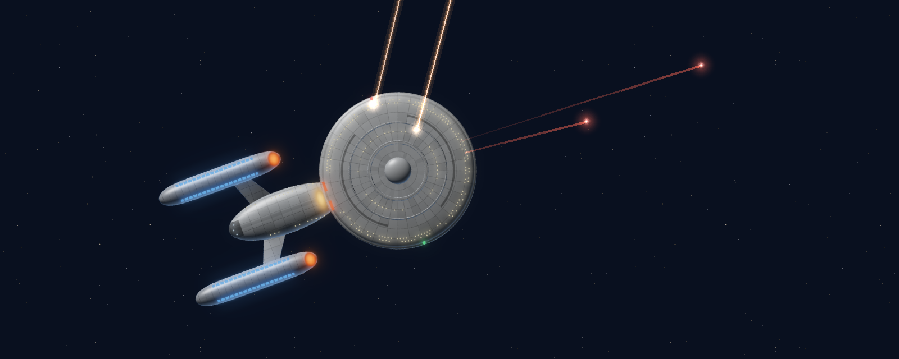
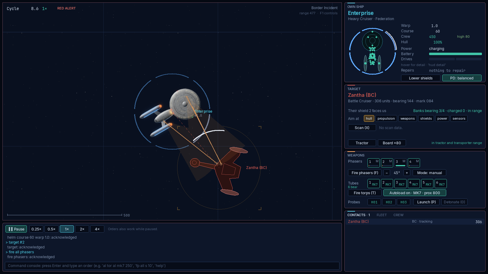
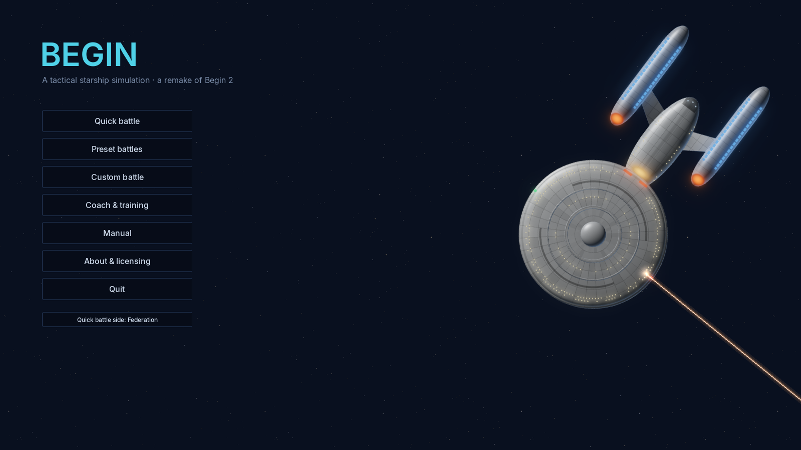
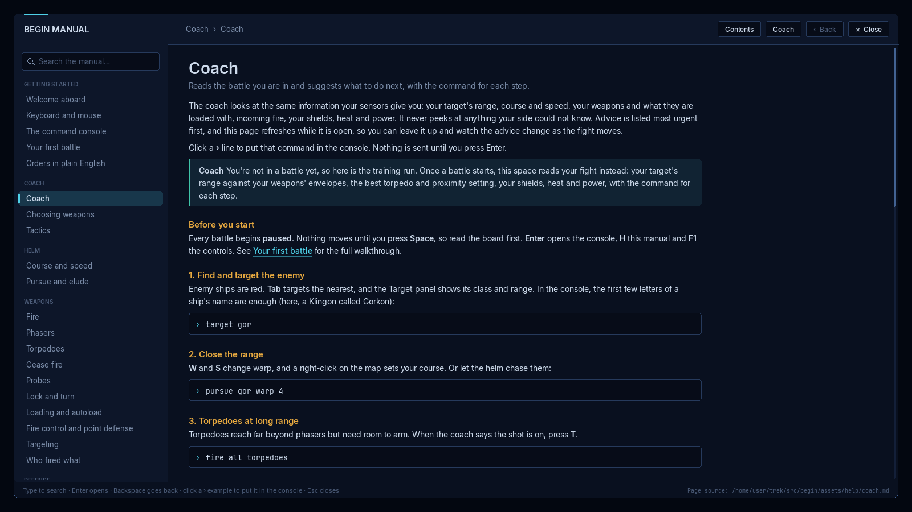
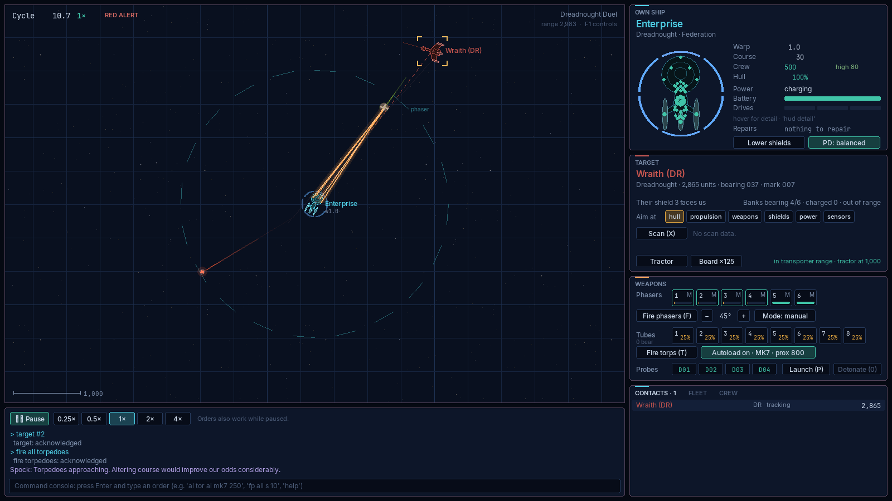
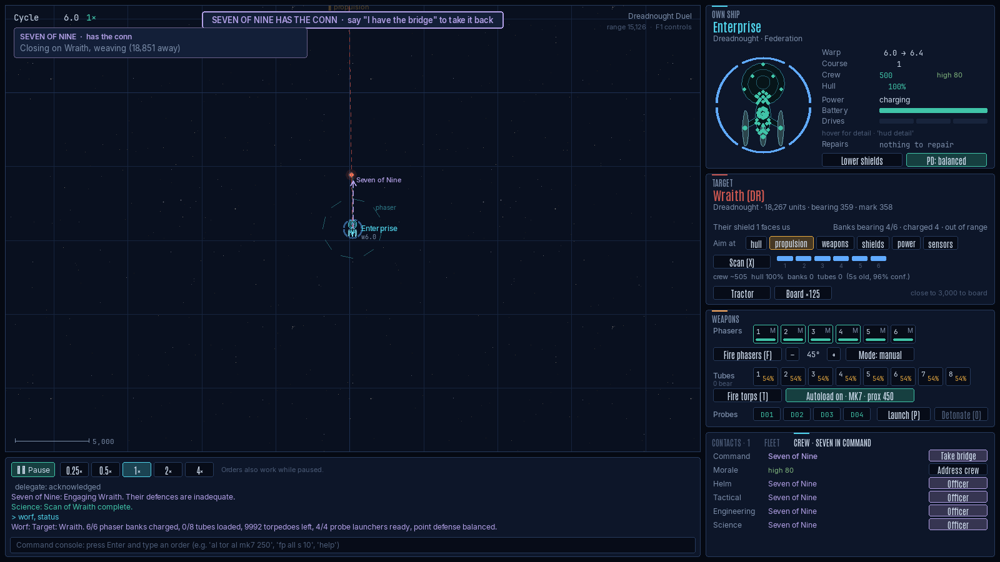
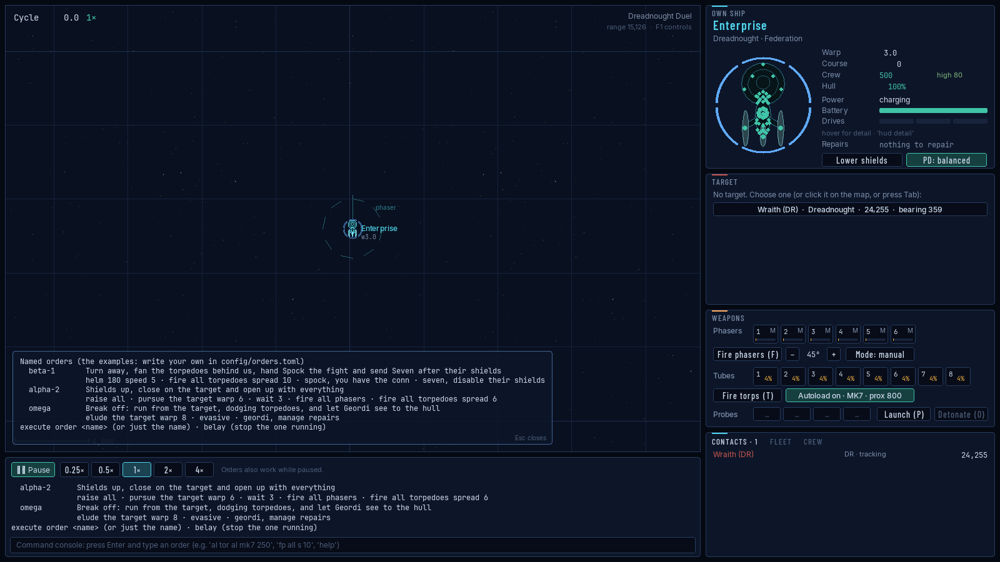
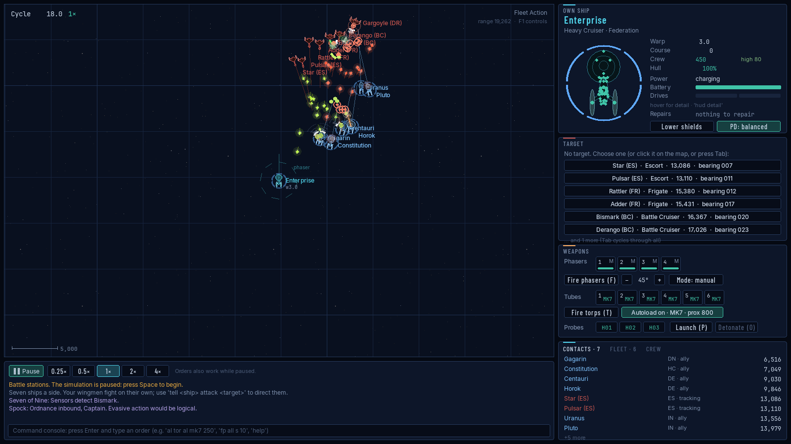
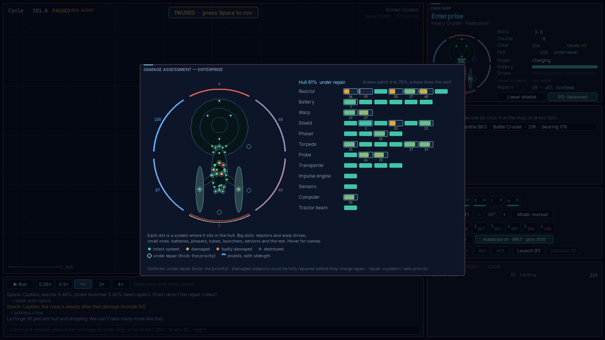
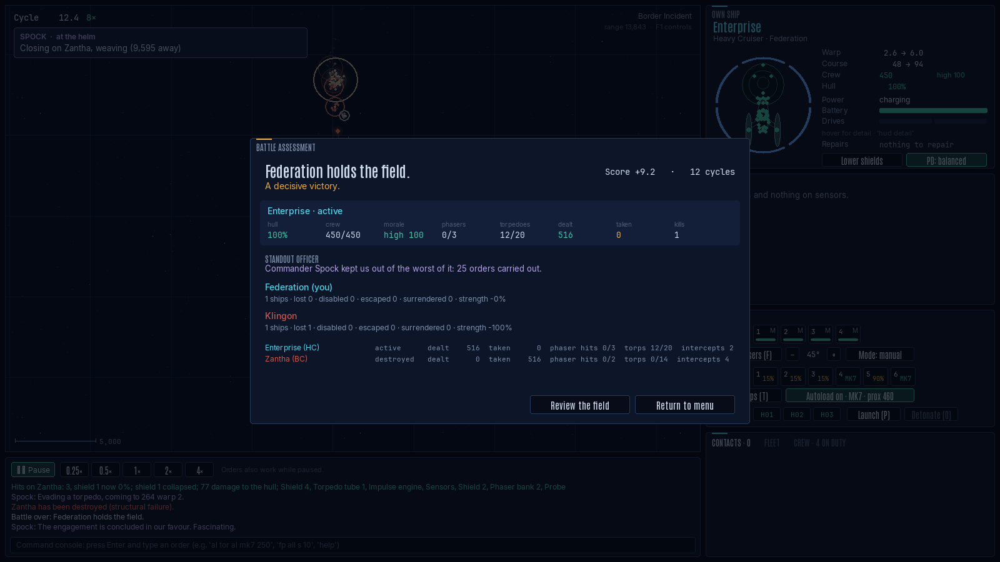

# Begin (remake)



A real-time 2D tactical starship simulation in Python and pygame-ce, rebuilt from *Begin: A Tactical Starship Simulation* (Clockwork Software, v1.65 manual with the Begin 2.0 appendix) and the [fireflyk64/begin](https://github.com/fireflyk64/begin) reverse-engineered reconstruction. It is a personal, non-commercial fan project: see [LICENSING.md](LICENSING.md).

You command a starship from a top-down tactical map and a Begin-style command console. The simulation keeps Begin's mechanics: six shield sectors, phaser banks that hit harder up close, torpedoes with arming and proximity fuses, heat, power, probes and cloaks. On top of that the remake adds a bridge crew who can fight the ship for you and talk back (optionally through a language model), named battle plans, a coach that reads the fight, crew morale, hull repairs, and synthesised sound and effects, with a HUD that keeps to the essentials until you ask for more.



## Run it

```bash
python3 -m venv .venv && source .venv/bin/activate
pip install -e ".[dev]"
begin                      # or: python -m begin
```

You need Python 3.10 or newer. macOS's system `python3` is 3.9, which is too old, so install a newer Python first (for example from python.org or with `brew install python`) and create the venv with it. On 3.10, `tomli` is installed automatically. Any Python version with a pygame-ce wheel works.

If `begin` works but `python -m begin` says `No module named begin`, the venv's `python` link points at a different Python from the one the game was installed into. That happens when a venv first made with macOS's Python 3.9 is upgraded in place. Check with `ls -l .venv/bin/python*`, then rebuild the venv with the newer Python (`python3.15 -m venv --clear .venv`, then reinstall), or just use the `begin` command.

Useful shortcuts:

| Command | What it does |
|---|---|
| `begin --preset border-incident` | Jumps straight into a preset battle (ids are in `src/begin/content/data/presets.toml`). |
| `begin --quick 42` | Starts seeded quick battle number 42: your ship against two enemies. |
| `begin --preset fleet-action --cycles 30 --screenshot shot.png` | Simulates 30 cycles headlessly and saves a screenshot. |
| `begin --tournament 20` | Runs 20 headless AI-versus-AI battles and prints a balance summary. |
| `begin --balance 8` | Fights every preset 8 times with AI captains on both sides and prints win rates. |
| `begin --llm provider=ollama model=lfm3 think=off` | Saves the officers' language model settings. |
| `begin --llm-test` | Asks Spock one question through that model and prints the answer and timing. |
| `pytest` | Runs the test suite. |

## Playing

### Before you start

The main menu sits over a slowly drifting starfield. Every so often the Enterprise sweeps across it from a new direction, at a new size and on a gently curving path, and on most passes she fires: a phaser volley from the saucer banks that face the unseen enemy, or a spread of torpedoes from the forward tubes. Then she is gone and the stars have the screen until the next pass. The menu's sound is quieter than the battle's. From the menu you can start quick, preset and custom battles, or open **Coach & training** (or **C**). That opens the coach before any battle, with a short training run: how to find and target the enemy, close the range, use torpedoes at long range and phasers up close, and keep a good shield toward them, each with the command to type. **Manual** (or **H**) opens the whole manual.





### The battle

Every battle starts paused. **Space** runs and pauses the clock, and **[** and **]** change the speed from 0.25× to 4×; one cycle is one second at 1×. You can give orders while paused. Press **F1** for the full controls and **H** for the manual.

Left-click a contact (or press **Tab**) to target it, and **R** cycles precision aim through propulsion, weapons, shields, power and sensors. Right-click the map to steer there, Shift + right-click a ship to pursue it, **W**/**S** change warp and **A**/**D** turn. **F** fires phasers, **T** torpedoes, **P** launches a probe and **X** scans the target. In the weapons panel, each weapon group can be Manual, Assisted or Automatic, and the **PD** button sets the point-defense doctrine.

The map shows what your sensors know and nothing more. Phaser beams glow around a bright core, torpedoes pulse as they fly and leave a trail that fades behind them, shields ripple along the struck arc, ships leave engine wakes and break up in shards and embers, and the panel borders pulse red at red alert. When you pick a target, its brackets swing in from wide and close on it, then pulse gently while the lock holds. Zoom right in on a Federation heavy cruiser and the map swaps the outline for the same lit, plated Enterprise as the menu.



### How much the HUD shows

The panels show what matters at a glance: warp, course, crew, hull, morale and shield arcs coloured by strength. Course and warp show where they are heading only while they are changing. Hover the mouse over the Own Ship panel to see every number (shield strengths, maximum warp, power in and out, the magazine), or type `hud detail` to keep them all on and `hud simple` to go back. Numbers ease to their new value instead of jumping, and flash briefly when they change: brighter for a rise, warmer for a fall.


### The console

Press **Enter** for a Begin-style console. Every command in the Begin manual works in its documented forms, such as `fire phasers 1 2 3 spread 10`, `lock all tubes on bluefin with a dispersion of 45`, `load launchers 1 prox 500 time 20` and `tell the agena to attack the zantha`. As in Begin, any word can be cut to a unique prefix, so `tor al` fires all torpedoes, and filler words such as "the" and "at" are ignored. The status commands (`report`, `damage`, `banks`, `tubes`, `shields`, `fleet`, `chart` and the rest) print Begin's text displays and keep them live in the corner of the map.

The remake adds `autoload`, `mode`, `pd`, `hud detail|simple`, `role`, `target <ship> <subsystem>`, `repair hull`, `evasive` (Federation ships dodge incoming torpedoes and then resume your course), `address crew <words>` to rally a shaken crew, `cease fire` (also `hold fire`, `stop firing`, or `seven, cease fire`) to stop every weapon and the officers' objectives until you fire again or say `open fire`, and `key F5 <commands>` to bind a key.

### Bridge officers

Spock (helm), Worf (tactical), Geordi La Forge (engineering) and Seven of Nine (science) can run their stations for you (`delegate tactical`, `delegate all`, or the toggles in the Crew tab), or take the whole bridge (`seven, take the bridge`; "I have the bridge" takes it back). Your own orders always override them for a few seconds, and they never retreat, surrender or self-destruct on their own. Talk to them by name, as in `spock, what do you recommend?` or `worf, fire all torpedoes`. Seven also takes standing objectives such as `seven, disable their shields`, and she and Spock can design a tachyon detector to find cloaked ships.



Officers answer offline from the battle state. With a language model (Anthropic, OpenAI, OpenRouter or a local Ollama: `begin --llm provider=ollama model=lfm3 think=off`, then `begin --llm-test`), they answer in their own words and you can type orders in plain English. Each officer has **traits** and a **response style** that shape how they talk; change them in `config/officers.toml` (copy `config/officers.example.toml`). Exact commands, abbreviations included, always run at once without the model. If the model takes more than 20 seconds to interpret a line, the console says so and runs nothing.

### Named orders

Write a battle plan before the fight in `config/orders.toml`: a name and a list of console lines, with `wait N` between steps, "their" meaning whatever you have targeted, and officer orders as steps. In battle, `execute order beta-1` (or just `beta-1`) runs it, `orders` lists them and `belay` stops one (and ceases fire). With a language model, plain-English steps are translated once and remembered.



### Allies and fleets

Click an ally to open the **Fleet** tab: escort, defend, attack my target, hold fire, run, withdraw, dock at a base, groups 1 to 3, beaming crew across and taking command of it. With an enemy targeted, the Target panel's **Tractor** and **Board** buttons lock a tractor beam and send a boarding party.



### How the AI fights

Enemy captains, and your allies, fight to their ship's strengths. Each one weighs its loadout against the target's: phaser banks and torpedo tubes on both sides, and how much punishment each hull and shield can take. A torpedo ship facing a phaser brawler holds its distance outside the enemy's banks (at least 1.3 times their reach) and works the tubes; it only closes once the target's scan shows its hull or shields failing. A ship with no tubes closes, because its banks are all it has, and a faster ship that is outgunned stays out of reach. When the shield facing the enemy drops below about a third, the captain turns a fresh one toward them. In AI-versus-AI testing over 420 battles this kept ships out of enemy phaser range noticeably more (27% of the time, against 32% before) and lifted survival in the big fights, for example Fleet Action from 86% to 93%.

### Damage, repairs and morale

Damage-control crews repair systems and now the hull too, slowly in space (up to 75%) and fully when docked; `repair hull` or `repair shields` sets the priority. Every crew has morale from 0 to 100, shaken by damage and losses and lifted by hits, kills and your `address crew`. It nudges repair speed, loading and accuracy, and a shaken AI crew gives up sooner. **I** (or a click on the hull diagram in the Own Ship panel) opens the damage assessment: every system where it sits in the hull, coloured by damage, with what the crews are repairing and the shields' strength around it.



### Sound

The game synthesises all of its sound when it starts. You only hear what you can see, panned to where it happens on the map. **M** mutes, `sound 40` sets the volume, and `sound phaser a` or `sound torpedo b` picks one of four versions of each (rays and buzzes, pulses and thumps). To use your own, drop `phaser.wav` or `torpedo.wav` into `config/sounds/` and it replaces the game's.

### After the battle

The assessment shows the score, your ship's record, every ship's damage and hits, and the officer who did the most for you.



### The manual and coach

`help` (or `man`) opens the in-game manual. It covers every command, grouped by station, with search, links and examples you can click into the console; `help tor` opens a command's page. `coach` reads your battle and suggests what to do next, most urgent first: whether the target is in your torpedo envelope, which warhead and proximity suit it, which shield to turn toward it. The manual is Markdown in `src/begin/assets/help/`, and a page of yours in `config/help/` replaces the bundled one.

## Your config folder

Everything you set lives in the project's [`config/`](config/README.md) folder, which git ignores apart from its README and the example files:

| File | What it holds |
|---|---|
| `settings.json` | Window, speed, volume, mute, sound versions, chatter, custom battle choices and the language model settings. The game writes it. |
| `officers.toml` | Your officers' traits and response styles. |
| `orders.toml` | Your named tactical orders. |
| `sounds/` | Your own WAV files, replacing the game's sounds. |
| `begin2.key` | Begin 2.0 key macros. |
| `help/` | Manual pages of your own. |

API keys never go there: they come only from environment variables.

## Project layout

```
src/begin/
  content/   TOML data (ship classes, ordnance, factions, doctrines, hulls, presets) and its typed loader
  core/      angles, vectors, deterministic RNG
  sim/       the authoritative simulation: ships, systems, commands, events, observations, world, scoring
  ai/        ship computer (point defense, assisted/automatic fire) and Begin-derived AI captains
  console/   the command parser, Begin's text displays, plain-English translation and named orders
  help/      the manual library (Markdown topics) and the live coach
  crew/      bridge officers: delegation, officer AI, conversation, rapport, traits, the end-of-battle review
  llm/       optional LLM providers (Anthropic, OpenAI, OpenRouter, Ollama) on a background thread
  assets/    fonts and the manual's Markdown pages
  ui/        pygame presentation: tactical map, HUD panels, menus, effects and synthesised sound
  battle.py  builds a World with AI attached from a battle description
config/      your settings, officers, orders, sounds, key macros and manual pages (gitignored apart from README and examples)
docs/        REFERENCE (mechanics digest), PLAN, ARCHITECTURE, EXTENDING, DEVIATIONS
tests/       headless tests
tools/       content importer from the reference data
```

Start with [docs/ARCHITECTURE.md](docs/ARCHITECTURE.md) for how the pieces fit together, and [docs/EXTENDING.md](docs/EXTENDING.md) to add ships, weapons, AI policies or HUD panels. [docs/DEVIATIONS.md](docs/DEVIATIONS.md) lists where the remake departs from Begin and why, and [LICENSING.md](LICENSING.md) covers the code, the original game and the fonts.
