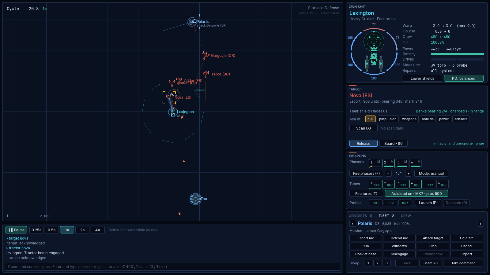

# Begin (remake)

A real-time 2D tactical starship simulation in Python and pygame-ce, rebuilt from *Begin: A Tactical Starship Simulation* (Clockwork Software, v1.65 manual with the Begin 2.0 appendix) and the [fireflyk64/begin](https://github.com/fireflyk64/begin) reverse-engineered reconstruction. It is a personal, non-commercial fan project: see [LICENSING.md](LICENSING.md).

## Run it

```bash
python3 -m venv .venv && source .venv/bin/activate
pip install -e ".[dev]"
begin                      # or: python -m begin
```

You need Python 3.10 or newer. macOS's system `python3` is 3.9, which is too old, so install a newer Python first (for example from python.org or with `brew install python`) and create the venv with it. On 3.10, `tomli` is installed automatically. Any Python version with a pygame-ce wheel works.

If `begin` works but `python -m begin` says `No module named begin`, the venv's `python` link points at a different Python from the one the game was installed into. That happens when a venv first made with macOS's Python 3.9 is upgraded in place. Check with `ls -l .venv/bin/python*`, then rebuild the venv with the newer Python (`python3.15 -m venv --clear .venv`, then reinstall), or just use the `begin` command.

Your settings, key macros and manual pages live in the project's [`config/`](config/README.md) folder, which git ignores apart from its README and an example settings file. API keys are never stored; they come from environment variables.

Useful shortcuts:

| Command | What it does |
|---|---|
| `begin --preset border-incident` | Jumps straight into a preset battle (ids are in `src/begin/content/data/presets.toml`). |
| `begin --quick 42` | Starts seeded quick battle number 42. |
| `begin --preset fleet-action --cycles 30 --screenshot shot.png` | Simulates 30 cycles headlessly and saves a screenshot. |
| `begin --tournament 20` | Runs 20 headless AI-versus-AI battles and prints a balance summary. |
| `begin --balance 8` | Fights every preset 8 times with AI captains on both sides and prints win rates. |
| `begin --llm provider=ollama model=lfm3 think=off` | Saves the officers' language model settings. |
| `begin --llm-test` | Asks Spock one question through that model and prints the answer and timing. |
| `pytest` | Runs the test suite. |

## Playing

Press **F1** in battle for the full controls list, or **H** for the manual. The essentials:

**Time**
- **Space** pauses and resumes. You can still give orders while paused.
- **[** and **]** change the speed between 0.25× and 4×. One cycle is one second at 1×.

**Targeting**
- **Left-click** a contact, or press **Tab**, to target it.
- Type `range 8000` in the console (or use the mouse wheel) to set the display radius; bare `range` reports it.
- **R** cycles precision aim through propulsion, weapons, shields, power and sensors.

**Helm**
- **Right-click** the map to steer toward that point.
- **Shift + right-click** a ship to pursue it.
- **W** and **S** change warp; **A** and **D** turn.

**Weapons**
- **F** fires phasers, **T** fires torpedoes, **P** launches a probe, and **X** scans the target.
- In the weapons panel, the **Mode** button switches a weapon group between Manual, Assisted and Automatic. The **PD** button sets the point-defense doctrine. Right-click a phaser bank to reserve it for point defense.

**Allies, tractor, docking and boarding**
- Click an ally on the map (or under **Contacts**) to open the **Fleet** tab: buttons for escort me, defend me, attack my target, hold fire, run, withdraw, dock at a base, groups 1 to 3, docking with that ally yourself, beaming crew across and taking command of it. Each ally's mission is written under its name, with faint lines to whoever its orders concern.
- With an enemy targeted, the Target panel's **Tractor** and **Board** buttons lock a tractor beam on it and send a boarding party, and the panel says when you are in range.



**Console**
- Press **Enter** to open a Begin-style console. Every command in the Begin manual works in its documented forms, for example `fire phasers 1 2 3 spread 10`, `lock all tubes on bluefin with a dispersion of 45`, `load launchers 1 prox 500 time 20`, `tell the agena to attack the zantha` and `order terra escort altair at 5000`.
- As in Begin, any word can be shortened to a unique prefix, so `fir tor al` fires all torpedoes and `fir tor 1,2,3` fires tubes 1 to 3. Filler words such as "the", "to", "at" and "on" are ignored.
- The status commands (`report`, `damage`, `banks`, `tubes`, `launchers`, `status probes`, `shields`, `fleet`, `chart`, `computer ...`) print Begin's text displays. The latest one stays in the map's lower-left corner and refreshes live until you press **Esc**.
- `beam <ally>` moves you to an ally ship within 3,000 units, `quit` ends the simulation, and `key F5 <commands>` binds a key to one or more commands separated by `;`.
- The remake adds `autoload`, `mode`, `pd`, `role`, `target <ship> <subsystem>`, `pause`, `resume` and `time`.

**Manual and coach**
- `help` or `man` opens the in-game manual: every command, grouped by station, with search, links and examples you can click to put in the console. `help tor` (or `man fire`, `help tell`, any short form) opens that command's page.
- `coach` opens a page that reads your current battle and suggests what to do next: whether your target is inside your torpedo envelope, which torpedo or probe suits it, which shield to turn toward it, and the command for each step. The weapon pages compare every torpedo and probe type with live numbers from the game data.
- The manual is a folder of Markdown files in `src/begin/assets/help/`. Edit them, or put your own pages in `config/help/` (a file with the same name replaces the bundled page). Changes show up the next time the page is opened. The format is described on the manual's "Writing help pages" page.


**Bridge officers**
- Four officers can run stations for you: Spock (helm), Worf (tactical), Scott (engineering) and Seven of Nine (science). `delegate tactical` (or `delegate all`) hands a station over, `assume tactical` takes it back, and the Crew tab has a toggle for each. Your own orders always override an officer for a few seconds, and officers never pick a different target from yours, retreat, surrender or self-destruct.
- Talk to them by name: `spock, what do you recommend?`, `worf, fire all torpedoes`, `scotty, take engineering`, `ask seven status`. Each officer only acts for their own stations. They comment on the battle as it happens (`crew chatter off` quiets them), and they remember how you treat them.
- Officers answer offline from the battle state. To have them answer in their own words, set an LLM provider (Anthropic, OpenAI, OpenRouter or a local Ollama), for example `begin --llm provider=ollama model=lfm3 think=off`, then check it with `begin --llm-test`. `think` turns a local model's thinking on or off. See the manual's "Officers and language models" page. API keys come only from environment variables.

## Project layout

```
src/begin/
  content/   TOML data (ship classes, ordnance, factions, doctrines, hulls, presets) and its typed loader
  core/      angles, vectors, deterministic RNG
  sim/       the authoritative simulation: ships, systems, commands, events, observations, world, scoring
  ai/        ship computer (point defense, assisted/automatic fire) and Begin-derived AI captains
  console/   the command parser and Begin's text displays
  help/      the manual library (Markdown topics) and the live coach
  crew/      bridge officers: delegation, officer AI, conversation, rapport
  llm/       optional LLM providers (Anthropic, OpenAI, OpenRouter, Ollama) on a background thread
  assets/    fonts and the manual's Markdown pages
  ui/        pygame presentation: tactical map, HUD panels, menus, effects
  battle.py  builds a World with AI attached from a battle description
config/      your settings, key macros and manual pages (gitignored apart from README and example)
docs/        REFERENCE (mechanics digest), PLAN, ARCHITECTURE, EXTENDING, DEVIATIONS
tests/       headless tests
tools/       content importer from the reference data
```

Start with [docs/ARCHITECTURE.md](docs/ARCHITECTURE.md) for how the pieces fit together, and [docs/EXTENDING.md](docs/EXTENDING.md) to add ships, weapons, AI policies or HUD panels. [docs/DEVIATIONS.md](docs/DEVIATIONS.md) lists where the remake departs from Begin and why, and [LICENSING.md](LICENSING.md) covers the code, the original game and the fonts.
